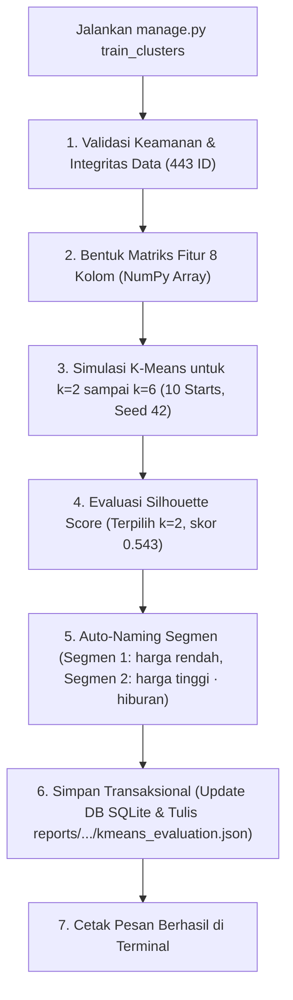

# Rangkuman Pembelajaran K-Means Clustering — TravelFit (SPK Destinasi Wisata)

Dokumen ini merangkum seluruh materi, penjelasan kode, konsep matematika, dan diskusi teknis mengenai modul **K-Means Clustering** yang digunakan pada proyek SPK Destinasi Wisata Jawa (TravelFit).

---

## 1. Arsitektur File & Penanggung Jawab Training

* **File Training Utama:**
  * [`recommender/management/commands/train_clusters.py`](file:///c:/Project%20Github/SPK_Destinasi_Wisata/recommender/management/commands/train_clusters.py)
  * Berisi implementasi K-Means murni dengan NumPy (*from scratch*), perhitungan Silhouette Score, *grid search* nilai $k=2..6$, pemberian nama segmen otomatis, dan pembaruan transaksional ke database SQLite serta laporan JSON.
* **File Pembentuk Fitur (Feature Engineering):**
  * [`recommender/data_pipeline.py`](file:///c:/Project%20Github/SPK_Destinasi_Wisata/recommender/data_pipeline.py) (fungsi [`build_features`](file:///c:/Project%20Github/SPK_Destinasi_Wisata/recommender/data_pipeline.py#L214-L233))
  * Menyiapkan 8 fitur: Z-score harga tiket (dengan p99 capping), Z-score rating model, dan *one-hot encoding* 6 kategori wisata.
* **Hasil Output:**
  * Database: Kolom `cluster_label` pada tabel `Destination` (443 baris).
  * Laporan: [`reports/clustering/kmeans_evaluation.json`](file:///c:/Project%20Github/SPK_Destinasi_Wisata/reports/clustering/kmeans_evaluation.json).

---

## 2. Kenapa Data Perlu Ditraining?

Data 443 destinasi wisata awalnya hanya berupa baris angka mentah (harga tiket, rating, kategori) tanpa konteks kelompok.
* **Tujuan Training (Unsupervised Learning):** Komputer dibiarkan belajar mandiri mencari pola kemiripan di antara 443 destinasi tanpa intervensi manual.
* **Hasil Nyata:** Setiap tempat wisata memperoleh label segmentasi pasar (misal: wisata terjangkau vs wisata hiburan komersial) yang memudahkan pengguna memahami karakter destinasi saat sistem SPK merekomendasikannya.

> [!NOTE]
> Pada sistem TravelFit, K-Means hanya digunakan untuk **profiling/segmentasi pasar *offline***, bukan untuk menyaring atau meranking rekomendasi. Perangkingan utama dilakukan secara dinamis oleh **AHP + TOPSIS** saat pengguna memasukkan kriteria di web.

---

## 3. Kenapa Terpilih 2 Cluster?

Pemilihan $k = 2$ didasari oleh dua faktor kuat:

### A. Alasan Matematis (Silhouette Score Tertinggi)
Kode menguji nilai $k$ dari 2 sampai 6. Nilai $k = 2$ menang mutlak dengan pemisahan paling tegas:

| Jumlah Cluster ($k$) | Silhouette Score | Keterangan |
| :---: | :---: | :--- |
| **$k = 2$** | **0.54302** | **Paling tegas & optimal (Terpilih)** |
| $k = 3$ | 0.28540 | Skor anjlok (kelompok tumpang tindih) |
| $k = 4$ | 0.24220 | Batas antarkelompok semakin kabur |
| $k = 5$ | 0.30824 | Kurang optimal |
| $k = 6$ | 0.35998 | Kurang optimal |

### B. Karakteristik Nyata Wisata di Pulau Jawa
Dari 443 destinasi, terdapat polarisasi alami harga tiket:
1. **Segmen 1 · harga rendah (414 destinasi / ~93%):**
   * Mayoritas wisata alam, budaya, dan bahari (pantai, curug, candi, museum).
   * Rata-rata tiket: **Rp 11.210**.
2. **Segmen 2 · harga tinggi · hiburan (29 destinasi / ~7%):**
   * Destinasi buatan modern (*theme park*, waterpark besar).
   * Rata-rata tiket: **Rp 212.551** (58.6% kategori hiburan).

Membagi data ini menjadi 3 atau 4 cluster justru akan memecah kelompok wisata murah yang padat secara tidak alami.

---

## 4. Memahami Metrik Silhouette Score

Skor Silhouette mengukur seberapa rapat suatu titik dengan kelompoknya sendiri (*cohesion* $a$) dibanding jaraknya ke kelompok lain terdekat (*separation* $b$):

$$s = \frac{b - a}{\max(a, b)}$$

* **Nilai Mendekati +1:** Data sangat cocok di kelompoknya dan terpisah jauh dari tetangga (kelompok ideal). Nilai **0.543** di data riil tergolong kuat.
* **Nilai Mendekati 0:** Data berada di perbatasan abu-abu (ragu-ragu).
* **Nilai Negatif:** Data salah masuk kelompok (lebih mirip ke kelompok sebelah).

---

## 5. Apa Maksud "Cocok Datanya"?

"Cocok" berarti **angka koordinat fitur-fiturnya berdekatan secara matematis (jarak Euclidean kecil)**:
* **Cocok (Satu Kelompok):** Pantai Klayar (tiket Rp 15.000, rating 4.5) dan Curug Nangka (tiket Rp 10.000, rating 4.4). Nilai angkanya setipe, posisinya berdekatan.
* **Tidak Cocok (Beda Kelompok):** Curug Nangka (Rp 10.000) vs Dufan Ancol (Rp 250.000). Jarak angkanya terpaut sangat jauh, sehingga tidak boleh disatukan.

---

## 6. Kenapa Hasilnya Dominan Membedakan Harga?

Meskipun model menggunakan **8 fitur** (harga tiket, rating, dan 6 kategori):
1. **Rating hampir seragam:** Rata-rata rating di Segmen 1 (4.443) dan Segmen 2 (4.434) hampir sama persis (~4.4). Karena tidak ada variasi tajam, rating tidak membelah data menjadi kelompok terpisah.
2. **Harga memiliki variasi ekstrem:** Rentang Rp 0 – Rp 25.000 vs Rp 150.000 – Rp 300.000 membuat fitur harga menjadi pembeda paling kontras.
3. **Kriteria lain (jarak & fasilitas) tidak dimasukkan ke K-Means:**
   * Jarak bersifat dinamis (tergantung kota asal yang dipilih user di web).
   * Fasilitas di deskripsi masih heuristik.
   * Kriteria ini seluruhnya diproses oleh **TOPSIS** secara *online*.

---

## 7. Konsep Teknis: `seed` dan Inisialisasi Titik Awal Acak

* **Kenapa butuh Titik Tengah (*Means / Centroid*)?**
  * Sebagai wakil resmi kelompok (merangkum profil harga & rating rata-rata).
  * Sebagai magnet penarik untuk mengelompokkan tempat wisata terdekat.
* **Kenapa di awal harus Acak (*Random*)?**
  * Komputer belum memiliki kunci jawaban sebaran data.
  * Acak diperlukan sebagai tebakan awal agar titik pusat tidak saling bertumpuk di titik nol.
  * Diulang 10 kali (*starts=10*) untuk mencari tebakan awal dengan hasil paling optimal.
* **K-Means++:** Titik acak awal tidak diletakkan sembarangan, melainkan disebar berjauhan agar kelompok cepat terbentuk rapi.
* **Fungsi `seed=42`:**
  * Mengunci algoritma pembangkit angka acak.
  * Menjamin hasil eksperimen **100% konsisten dan dapat direplikasi (*reproducible*)** kapan pun dan di laptop mana pun kode dijalankan.

---

## 8. Kenapa Output Berupa JSON, Bukan File `.pt`?

* **File `.pt`:** Format serialisasi PyTorch khusus untuk Deep Learning / Jaringan Saraf Tiruan yang menyimpan jutaan bobot matematis biner (tensors).
* **Format `.json` di Projek Ini:**
  * K-Means adalah Machine Learning / Data Mining klasik, bukan Deep Learning.
  * Yang dihasilkan sangat ringkas: 2 koordinat titik pusat, skor evaluasi, dan daftar label.
  * Format teks JSON bersifat transparan, dapat dibaca langsung oleh manusia (*human-readable*), dan berfungsi sebagai bukti audit ilmiah/skripsi.
  * Sangat ringan: tidak memerlukan library PyTorch yang memakan memori 1–2 GB.
  * Label segmen praktisnya sudah langsung tersimpan di database SQLite (`Destination.cluster_label`).

---

## 9. Alur Eksekusi Kode Training dari Awal hingga Akhir

1. **Validasi:** Memastikan 443 destinasi utuh dan hash snapshot data cocok.
2. **Matriks Fitur:** Mengubah 8 kolom data (Z-score harga, Z-score rating, 6 kategori) menjadi matriks numerik NumPy.
3. **Looping $k=2..6$:** Menjalankan algoritma K-Means (Lloyd's iteration) dengan K-Means++ dan multi-start 10x.
4. **Seleksi:** Memilih $k$ dengan skor Silhouette tertinggi yang memenuhi syarat ukuran minimum cluster $\ge 5\%$.
5. **Penamaan:** Memberi nama label deskriptif berdasarkan rata-rata harga dan kategori dominan.
6. **Penyimpanan:** Memperbarui database SQLite secara *bulk update* dan mempublikasikan laporan evaluasi JSON dengan proteksi staging/atomic.
